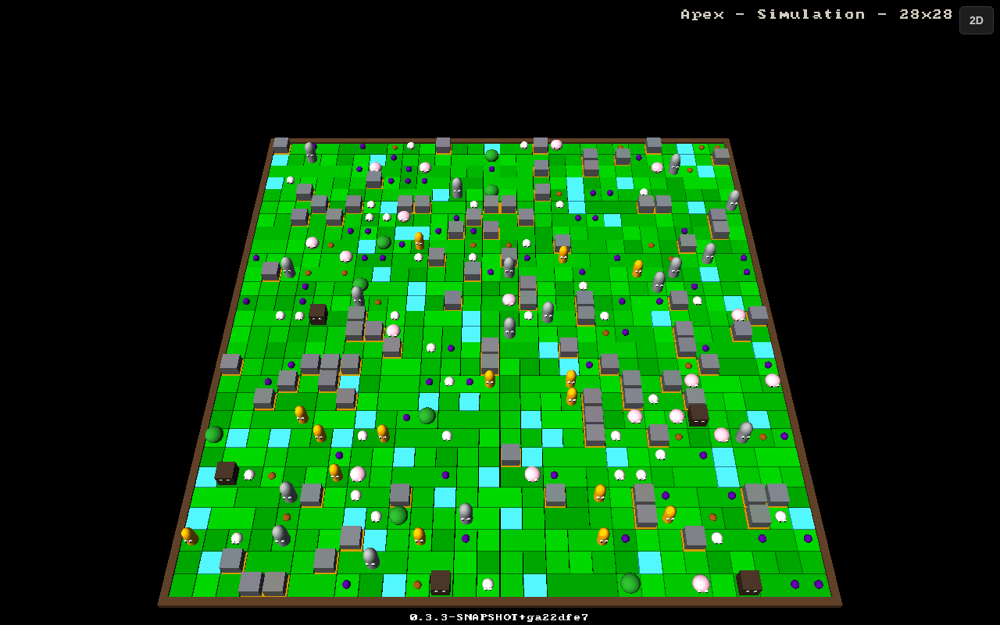
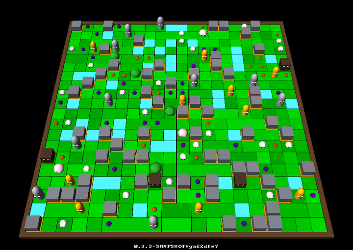
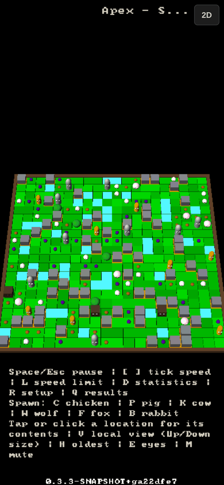
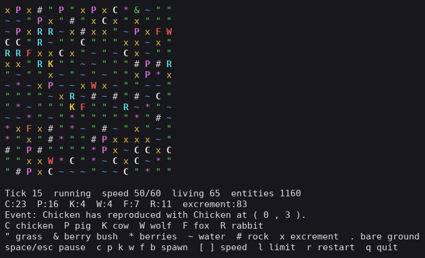
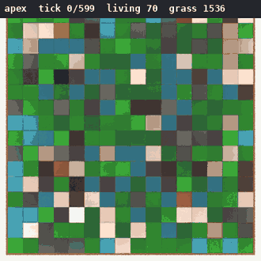

# Apex

[](https://danielstephenson.dev/play/apex)

This game allows you to manage a virtual environment containing entities that depend on each other as sources of energy. A food chain arises from the configuration of various entities and their specified diets.



<sub>A simulation a few ticks in, drawn in 3D by [Strata](https://github.com/Preponderous-Software/strata) in the browser build ([play it](https://apex.play.danielstephenson.dev)). The classic 2D window is still there: see [Screenshots](#screenshots).</sub>

## Play in your browser
Apex also runs in a web browser, phones included, with nothing to install:

- https://apex.play.danielstephenson.dev
- https://danielstephenson.dev/play (every browser game in one place)

Click or tap the page once to start it, then tap "create new sim" and "start simulation", and
watch. Tapping the results screen returns to setup. The keyboard controls below work there too,
except that q ends the simulation (showing its results) instead of quitting, and there is no quit
button, as closing the tab ends the game. Nothing is reported to trace from the browser. On a
phone (any touch screen) the simulation's keys are buttons along the bottom of the screen, in the
2D and the 3D view alike, each pressing the key it names: **Pause**, **Stats**, **Slower**,
**Faster**, **Limit**, **+Chick**, **+Pig**, **+Cow**, **+Wolf**, **+Fox**, **+Rabbit**,
**Local**, **Wider**, **Nearer**, **Oldest**, **Eyes**, **Mute**, **Setup** and **End**, with
**More** paging through them. They show only on a touch screen, below the board, never over it.

The game starts in 3D, drawn with [Strata](https://github.com/Preponderous-Software/strata), as
on the desktop (the 3D view, about 1.3 MB, loads alongside the game). The **2D** button in the
top-right corner switches to the 2D view, and **3D** back, on any screen and in the middle of a
simulation. It is the same game either way: the 3D menus are the 2D screens' own buttons (made
big enough to tap on a phone), the keys are the same, and a tap or click on a tile shows that
location's contents beside it. The browser remembers your choice; `?view=2d` or `?view=3d` in the
address picks a view for that visit (a 2D visit downloads nothing of the 3D view). Where 3D
can't run (no WebGL 2, say), the 2D view stays and the page says why.

The browser build is made with [pygbag](https://github.com/pygame-web/pygbag) from `src/`, whose
`main.py` is its entry point (`python -m pygbag --build src` builds it into `src/build/web`). pygbag packs
only what is under `src/`, so copy the pinned graphik release in first with
`python -m pip install --no-deps --target src "$(grep -E '^graphik @ ' requirements.txt)"`, as the workflow does;
neither `src/build/` nor `src/preponderous/` is committed. For the 3D view, build with graphik's
page template (`--template`, its path from `preponderous.graphik.grid3d.web.templatePath()`) and
copy Strata's grid relay next to the page with
`python -m preponderous.graphik.grid3d.relay --strata 0.9.0 --dest src/build/web`, as the workflow does.
`.github/workflows/browser.yml` builds it on every pull request and deploys it. The sounds ship as
`.ogg` copies alongside the `.wav` files, because a browser build cannot play `.wav`.

### Play in 3D or 2D
- **3D** (the default): https://apex.play.danielstephenson.dev
- **2D**: https://apex.play.danielstephenson.dev/?view=2d

The **2D**/**3D** button in the top-right corner switches between them at any time, and the
browser remembers the choice; `?view=2d` or `?view=3d` picks a view for one visit.



<sub>A real run of the browser build in 3D at a desktop window size (1280x800), about 180 ticks
shown as a time-lapse (one frame every few ticks).</sub>



<sub>The 3D view on a phone (390x844).</sub>

## Run on your computer
Install the dependencies (pygame, graphik and, on Linux and Windows, Strata's Python binding
`strata-engine`), then start the game. graphik needs Python 3.9 or newer.
```bash
pip install -r requirements.txt
./run.sh
```
On Windows, run `run.bat` instead of `./run.sh`.

### 3D window (default on Linux and Windows)
On Linux and Windows, Apex opens in a 3D window drawn with
[Strata](https://github.com/Preponderous-Software/strata), through graphik's 3D grid view.
That view needs Strata's Python binding, `strata-engine` (the package graphik's `strata` extra
names). `requirements.txt` installs it on Linux and Windows, pinned to the same Strata release,
so the install above is enough; it is skipped on other systems, which open the 2D window.
The first start downloads Strata's library for your system (checked against a pinned SHA-256).
If the 3D window can't start (the package isn't installed, no graphics driver, macOS), Apex says
why and opens the 2D window instead; `--strata` insists on 3D and stops with the reason instead.
`--2d` opens the classic 2D pygame window directly. The 3D window has every screen, button, key
and readout the 2D one has: the menus are the 2D screens' own buttons, the keys below go through
the same handler, and a click on a tile shows that location's contents and selects its animal.
One window-level difference comes from Strata itself: it can't retitle an open window, so the
simulation's caption (its size, and "(muted)") is shown in the top-right corner instead. F11
switches to fullscreen with Strata 0.8.0 or newer (an older Strata says it can't). The browser
build has a 3D view too (see "Play in your browser").

`tools/strata_snapshot.py --out shots/` renders every screen of the 3D window headless to PNGs.

## Types of Living Entities
- Chicken
- Pig
- Cow
- Wolf
- Fox
- Rabbit

Each of these attempt to gain energy and reproduce. At the bottom of the food chain is Grass, which chickens, pigs, cows and rabbits are able to eat.

Berry bushes are a second food source. A bush that has accumulated enough energy periodically grows Berries on its own location, up to a cap. Chickens, pigs and rabbits eat berries; pigs can also eat the bush itself. Cows eat grass only.

Foxes hunt chickens, pigs and rabbits. Wolves hunt those three as well as cows and foxes.

Without grass, cows starve, and every other species depends on the berries the remaining bushes grow.

## How does grass respawn?
Living entities spawn excrement when their energy needs are met and this turns into grass over time. The grow time, shared by all excrement in a simulation, is picked at random between 100 and 299 ticks, and excrement next to water turns into grass in half that time.

## Controls
Key | Action
------------ | -------------
space / escape | pause/unpause
m | mute/unmute
h | highlight oldest living entity
e | toggle entity eyes
v | toggle view (global/local)
up | increase view distance (in local view)
down | decrease view distance (in local view)
d | debug mode
c | spawn a chicken
p | spawn a pig
k | spawn a cow
w | spawn a wolf
f | spawn a fox
b | spawn a rabbit
l | toggle tick speed limit
] | increase tick speed (if enabled)
[ | decrease tick speed (if enabled)
f11 | toggle fullscreen mode
r | restart
q | quit (in the browser: end the simulation and show its results)
click | show a location's contents and select its living entity (global view)

The same keys work in the 2D and 3D windows.

## Text mode
`--text` runs the simulation in a terminal instead of a pygame window, no window or sound needed:

```bash
python3 src/apex.py --text
```



The grid is drawn one character per location, showing the entity on top as the window does:
`C` chicken, `P` pig, `K` cow, `W` wolf, `F` fox, `R` rabbit, `"` grass, `&` berry bush, `*` berries,
`~` water, `#` rock, `x` excrement and `.` bare ground. Below it are the tick count, the population of
each species, the latest event (a death or a birth) and the legend. Colour is used where the terminal
supports it, and the letters alone are enough where it does not. A terminal too small for the grid
shows as much of it as fits.

Key | Action
------------ | -------------
space / escape | pause/unpause
c / p / k / w / f / b | spawn a chicken / pig / cow / wolf / fox / rabbit
] / [ | increase / decrease tick speed
l | toggle tick speed limit
r | start a new simulation
q | quit (the environment summary is printed once the terminal is restored)

When every living entity has died the simulation stops and waits for r or q. Text mode needs
Python's `curses` module, which Linux and macOS include; on Windows, `pip install windows-curses`
first. `--record` is not available in text mode, and the browser build is unaffected.

## Recording a replay
`--record <path.usda>` records the first simulation's history as a time-sampled
[OpenUSD](https://openusd.org) stage, one time code per tick (30 per second), that can be scrubbed in
usdview, Blender or any USD tool. It needs the optional
[usd-recorder](https://github.com/Preponderous-Software/usd-recorder) package (Python 3.10 or newer;
it brings in `usd-core` and `numpy`), which the game does not otherwise need:

```bash
pip install -r requirements-record.txt
python3 src/apex.py --record run.usda
```

Start a simulation as usual; the file is written when that simulation ends (or when you restart or
quit), and later simulations are not recorded. Every entity is recorded at `(x, y, layer)`, where
`layer` is its place in its location's stack (the top one is what the game draws), in the game's
colour, with its `kind` (`Grass`, `Chicken`, `Wolf`, ...) and, for living entities, its `energy`;
the stage carries the `livingEntities`, `grass` and `excrement` counts per tick. Without `--record`
nothing is recorded or imported, and the browser build is unaffected.



The replay above is a 600-tick simulation on a 16×16 grid (6,407 entities over the run, a 10 MB
stage), recorded headlessly by stepping `Simulation` and `UsdRecording` tick by tick the way the
simulation screen does, then rendered top-down with headless Blender's USD importer and Cycles in
the recorded colours.

## Usage reporting
Usage reporting is on by default: Apex sends its name (`apex`), the version from `version.txt` and the events `startup` (when the game starts) and `simulation-started` (when a simulation begins) to [trace](https://danielstephenson.dev/usage-reporting) at `https://trace.danielstephenson.dev`. Each event also carries a random installation ID (the tag `install`) so installations can be counted rather than events; beyond that, nothing about you, your machine, your IP address or the simulation's contents is sent. The reporting happens on a background thread, never blocks the game, and is dropped silently if the service is unreachable.

The first run creates a `settings.json` next to `version.txt` and prints a one-line notice. If `TRACE_USAGE_REPORTING` or `DO_NOT_TRACK` already turns reporting off on that first run, the block is written with `"enabled": false`, so reporting stays off on later runs without the variable.

The installation ID is a random UUID kept in `trace-install-id` under the user data directory: `~/.local/share/apex/` on Linux (or `$XDG_DATA_HOME/apex/`), `~/Library/Application Support/apex/` on macOS and `%APPDATA%\apex\` on Windows. It identifies no person, account or address; delete the file to get a new one. Setting the environment variable `TRACE_INSTALL_ID` sends that value instead and leaves the file alone. The file is only created while reporting is on, so every opt-out below also stops it. The browser build never reports, so it has no ID.

To turn reporting off, any one of these is enough:

- `"usage_reporting": {"enabled": false}` in `settings.json`:

  ```json
  {
      "usage_reporting": {
          "enabled": false
      }
  }
  ```

- the environment variable `TRACE_USAGE_REPORTING=off` (any value other than blank, `true`, `on`, `yes` or `1` counts), which turns off every program that reports to trace
- the environment variable `DO_NOT_TRACK=1` (any value other than blank, `0`, `false`, `off` or `no` counts; see [consoledonottrack.com](https://consoledonottrack.com))

Every switch fails closed: `enabled` reports only when it is `true` (or the string `"true"`, `"on"`, `"yes"` or `"1"`); `"false"`, `"off"`, `0`, `null`, a typo or `"usage_reporting": false` all keep reporting off. A `settings.json` that cannot be read or is not a JSON object turns reporting off and is never overwritten. The environment variables win over `settings.json`. The `usage_reporting.endpoint` and `usage_reporting.key` entries in the same block select where reports go and the key they are sent with. An opt-out written under another spelling also counts as off: a block named `usage-reporting`, `usageReporting` or `UsageReporting`, an `enable`/`Enabled` switch that is not clearly on, or `"disabled": true`; the first run then writes `"usage_reporting": {"enabled": false}` next to it.

Details: https://danielstephenson.dev/usage-reporting

## Research
See [RESEARCH.md](RESEARCH.md) for the ecological and artificial-life research this simulator's mechanics are grounded in, and how to use it when designing new features.

## Support
You can find the support discord server [here](https://discord.gg/49J4RHQxhy).

## Authors and acknowledgement
### Developers
Name | Main Contributions
------------ | -------------
Daniel Stephenson | Creator

## Inspiration
This project is based on [Kreatures](https://github.com/Stephenson-Software/Kreatures) and [Interakt](https://github.com/Stephenson-Software/Interakt).

## Libraries
This project makes use of [graphik](https://github.com/Stephenson-Software/graphik), installed from a release tag pinned in `requirements.txt`, and [py_env_lib](https://github.com/Preponderous-Software/py_env_lib), vendored under `src/lib/`.


## Screenshots

The 2D window:


## Sounds
- Pop sound source: https://mixkit.co/free-sound-effects/pop/
- Death sound source: https://soundbible.com/1454-Pain.html

## 📄 License

This project is licensed under the **Preponderous Non-Commercial License (Preponderous-NC)**.  
It is free to use, modify, and self-host for **non-commercial** purposes, but **commercial use requires a separate license**.

> **Disclaimer:** *Preponderous Software is not a legal entity.*  
> All rights to works published under this license are reserved by the copyright holder, **Daniel McCoy Stephenson**.

Full license text:  
[https://github.com/Preponderous-Software/preponderous-nc-license/blob/main/LICENSE.md](https://github.com/Preponderous-Software/preponderous-nc-license/blob/main/LICENSE.md)
